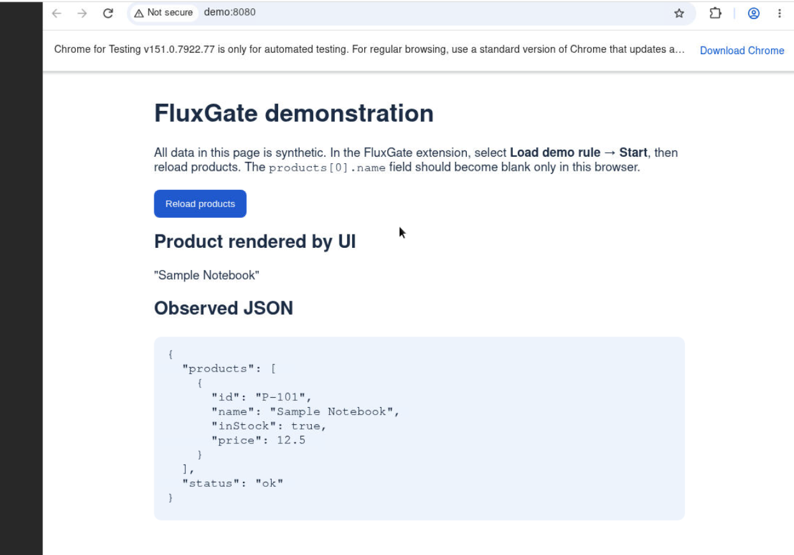
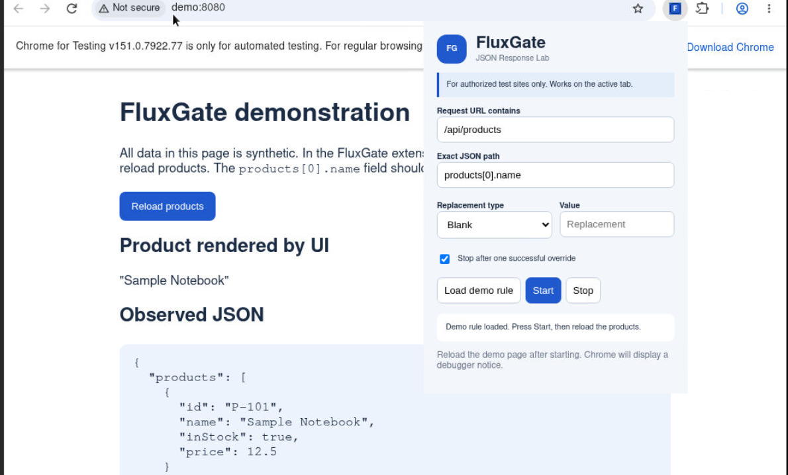
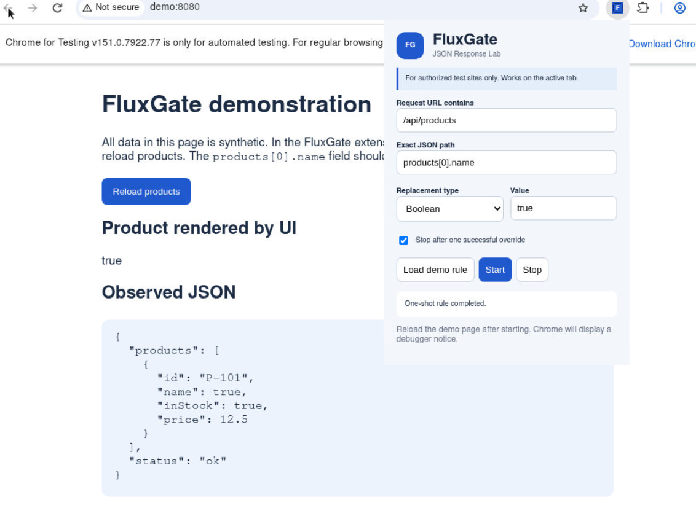
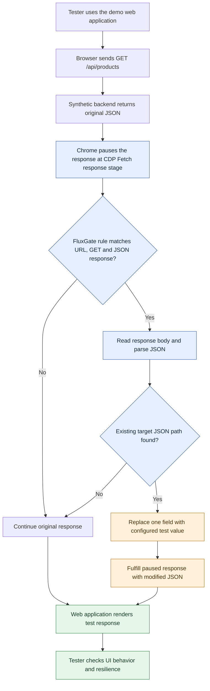
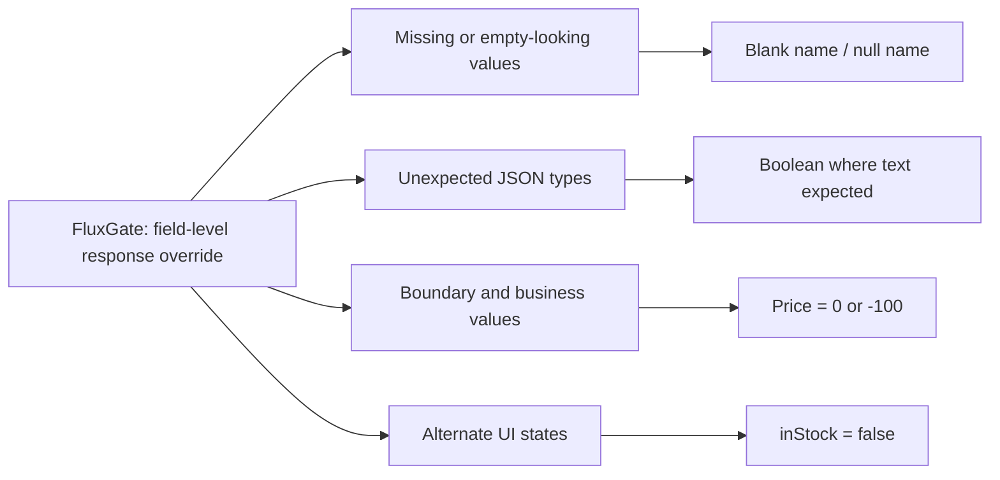

# FluxGate

**Browser API Response Fault-Injection Lab · Chrome DevTools Protocol · Docker · GitHub Codespaces**

FluxGate is a lightweight testing lab for **modifying a JSON API response inside a test browser**, without changing the backend service. Use it to explore how a frontend handles missing fields, unexpected values and type mismatches.

**No local Docker installation needed:** launch the included Chrome browser from **GitHub Codespaces** and access it through a private, password-protected noVNC session.

> **For authorized testing only.** This is a development lab, **not** a public browsing service, security scanner or network-wide proxy. Keep Codespaces port **6080 Private**. The container's Chrome sandbox is disabled by default; never use it for personal accounts or untrusted websites.

## See it in action

### 1. Before: synthetic store returns its normal API response



The demo endpoint returns a product named `Sample Notebook`.

### 2. Configure a JSON response override



In the remote Chrome browser, open the **FluxGate** extension. Choose **Load demo rule** for a preset, or configure your own rule: URL contains `/api/products`, JSON path `products[0].name`, and a replacement type.

### 3. After: changed response appears in the UI



This real Codespaces test changed `products[0].name` from `"Sample Notebook"` (string) to `true` (boolean). The UI rendered `true`, while the extension reported **One-shot rule completed**. This is an example of **type-mismatch fault injection**. The backend's original API response is not changed.

## Quick start: GitHub Codespaces (recommended)

1. Open the repository on GitHub. Select **Code → Codespaces → Create codespace on main**.
2. In the Codespaces terminal, run:

   ```bash
   docker compose config --quiet
   docker compose up --build -d
   docker compose ps
   ```

3. Retrieve the temporary VNC password **privately**:

   ```bash
   docker compose logs fluxgate | grep -i password
   ```

   **Never commit or share the password.**

4. In Codespaces **Ports**, locate **6080**, verify **Visibility: Private**, and open the forwarded address. If you see a directory listing, click `vnc.html`, or append `/vnc.html?autoconnect=true&resize=scale` to the forwarded URL.
5. Enter the VNC password. You should see **Chrome for Testing** showing the built-in synthetic store at `http://demo:8080` **inside the container**.
6. Click the Chrome extensions (puzzle-piece) icon → **FluxGate** → **Load demo rule** → **Start**. On the store page click **Reload products**.
7. With the default **Blank** replacement, `products[0].name` becomes `""` (empty string). Alternatively, choose **Boolean**, enter `true`, and run the test to reproduce the screenshot above.
8. To restore the original response, click **Stop**, then **Reload products**. When **Stop after one successful override** is enabled, the extension stops automatically after one successful modification.

> **Important:** Open the extension in the **remote Chrome window shown inside noVNC**, not in your laptop's normal Chrome. The intercept is limited to the active tab in that container browser.

## Quick start: local Docker

Requires Docker Engine / Docker Desktop with Compose V2:

```bash
docker compose up --build -d
docker compose logs fluxgate | grep -i password
```

Open `http://localhost:6080/vnc.html?autoconnect=true&resize=scale`. Follow the same demo steps. No external API account or company VPN is needed for the included example.

Stop the lab with `docker compose down`. To discard the browser profile too, run `docker compose down -v` (**removes saved browser state**).

## What FluxGate can do

| Feature | Status |
| --- | --- |
| Intercept matching **GET JSON responses** in active Chrome tab | Supported |
| Match request URL by substring | Supported |
| Update **an existing** nested JSON property, e.g. `products[0].name` | Supported |
| Replace with blank, null, string, number, boolean or parsed JSON | Supported |
| One-shot or continuous interception | Supported |
| Remember last configured rule locally | Supported |
| Override HTTP status codes or modify requests | **Not supported** |
| Create missing JSON paths or rewrite binary/streaming responses | **Not supported** |
| Use as transparent proxy or security scanner | **Not supported** |

More hands-on examples are in [docs/TEST-SCENARIOS.md](docs/TEST-SCENARIOS.md).

## How FluxGate works



The application makes a normal API call and the backend returns its normal JSON. **Before the browser page consumes the response**, FluxGate's MV3 service worker uses Chrome DevTools Protocol (CDP) to inspect and, for a matching rule, change **one existing JSON field**. The replacement is visible **only in the selected browser tab**; the backend response is not changed at its source. Nonmatching responses pass through. See [Architecture](docs/ARCHITECTURE.md) for the detailed interception flow and deployment setup.

## What can I test with it?



| Example rule | Testing purpose | Expected observation |
| --- | --- | --- |
| `products[0].name` → Blank | Empty-state handling | No broken layout or exception |
| `products[0].name` → Null | Null-safety | UI handles a null product name |
| `products[0].name` → Boolean `true` | Schema/type resilience | UI handles an unexpected type (shown in our demo screenshot) |
| `products[0].price` → Number `0` | Boundary values | Price formatting and zero-price decisions |
| `products[0].price` → Number `-100` | Invalid business value | Validation, messaging or graceful handling |
| `products[0].inStock` → Boolean `false` | Alternate UI flow | Availability state updates correctly |

**Scope:** This is **field-level response mocking of existing GET JSON responses**, not a general mock server. It cannot invent a missing response, create a missing JSON field, replace HTTP status codes or intercept arbitrary non-JSON bodies. For complete exercises see [Test scenarios](docs/TEST-SCENARIOS.md).

## Run tests

```bash
node --test extension/tests/*.test.mjs
python -m unittest discover -s tests -v
docker compose config --quiet
```

The core JSON-editing tests and GitHub Actions workflow have passed, and a real Codespaces demonstration has confirmed response modification. **These checks do not imply that every replacement mode or arbitrary website has been end-to-end tested.**

## Troubleshooting

Read [docs/TROUBLESHOOTING.md](docs/TROUBLESHOOTING.md) if the forwarded URL shows a directory listing, Chrome doesn't load, the extension is missing or a rule doesn't match.

## Security and provenance

Read [SECURITY.md](SECURITY.md) and [LICENSE-NOTE.md](LICENSE-NOTE.md). **The repository is intentionally private while publication/IP rights are checked.** Removing employer-specific references alone does not authorize public distribution. No open-source license has been granted yet.
