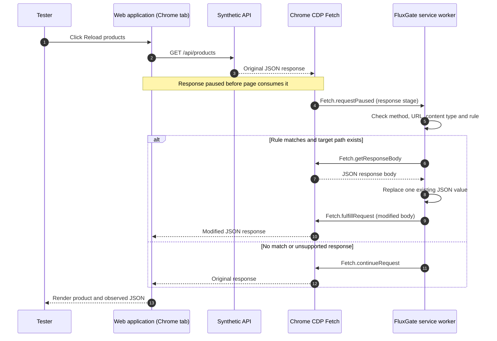
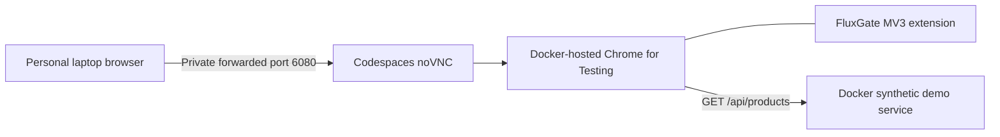

# Architecture

## Components

| Component | Responsibility |
| --- | --- |
| `demo/server.py` + `demo/index.html` | Synthetic product API and a browser UI showing rendered data and raw JSON |
| `Dockerfile`, `start.sh` | Installs and starts Chrome for Testing, Xvfb, window manager, VNC and noVNC |
| `docker-compose.yml` | Starts `demo` and `fluxgate`, and mounts a disposable browser-profile volume |
| `extension/manifest.json` | MV3 manifest, `debugger`, `activeTab`, and `storage` permissions |
| `extension/popup.html`, `popup.js`, `popup.css` | Rule editor and Start/Stop controls |
| `extension/worker.js` | Attaches Chrome debugger and intercepts paused CDP response events |
| `extension/engine.js` | Input conversion, eligibility checks and safe JSON path editing |

## Request flow

1. The test UI requests `GET /api/products` from `demo:8080` inside Docker.
2. The FluxGate service worker attaches CDP to the **active tab** and enables `Fetch` interception at the **Response** stage.
3. It compares a paused response's URL fragment, method and response content type against the active rule.
4. For a match, the worker obtains and parses the JSON response body.
5. The pure JSON editor replaces **one already-existing** field, preserving all other values.
6. The worker fulfills the paused response with the modified body, preserving the response status and filtering body-dependent headers.
7. The demo page renders the modified JSON. The synthetic backend remains unchanged.
8. For one-shot rules, the worker detaches after a successful override.

## Boundaries

FluxGate is a **browser-scoped** response override, not a server-side proxy. The app's popup may show a Chrome debugger warning when active. The stored rule belongs to the local disposable browser profile and should not be treated as a secret store. Only use authorized websites and non-sensitive test identities.

No arbitrary HTTP status rewriting, request modification, network capture, binary response rewriting or authentication bypass is implemented.

## Interception sequence

This is scoped to **one attached tab** and uses response-stage interception. It does **not** alter the actual API's stored data or provide a network-wide proxy.

## Container access path

Keep forwarded port 6080 private and use only test websites. The container Chrome launch disables its sandbox and is not intended for general-purpose browsing.
